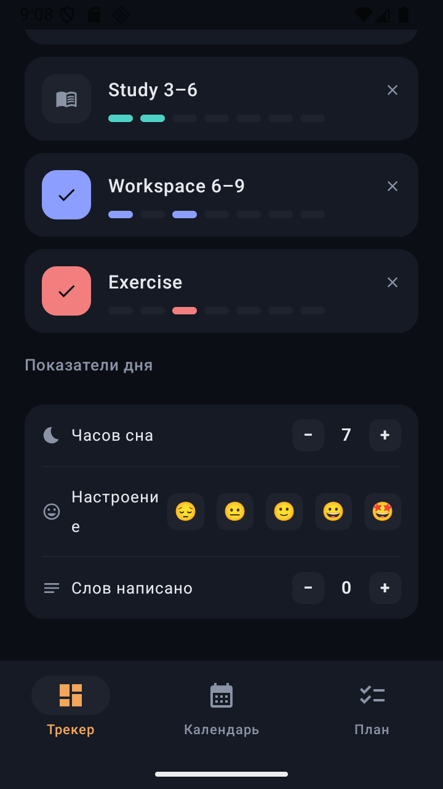
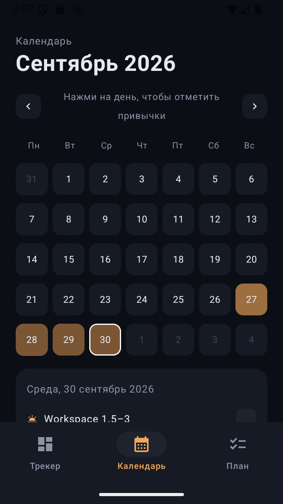
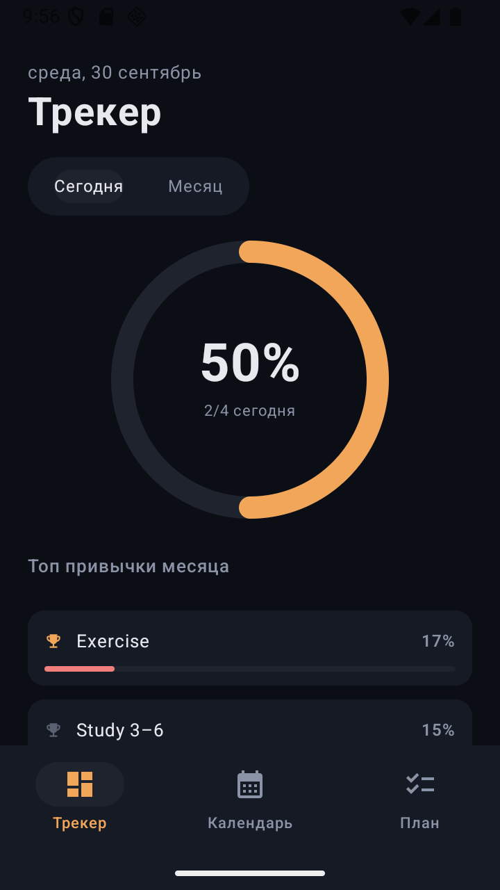
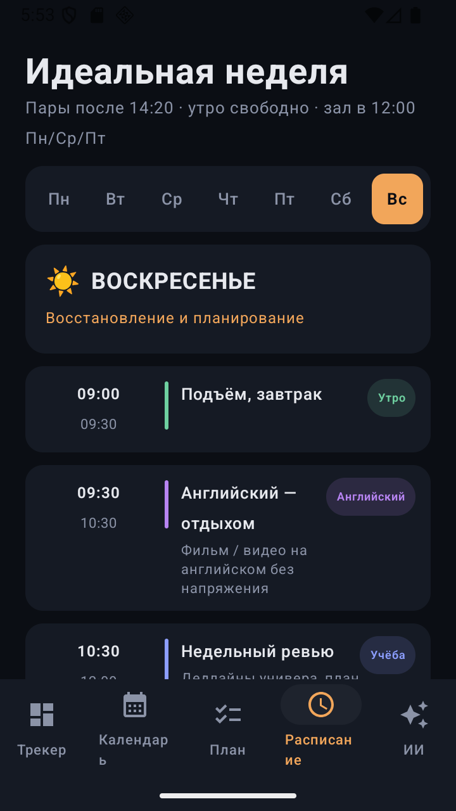
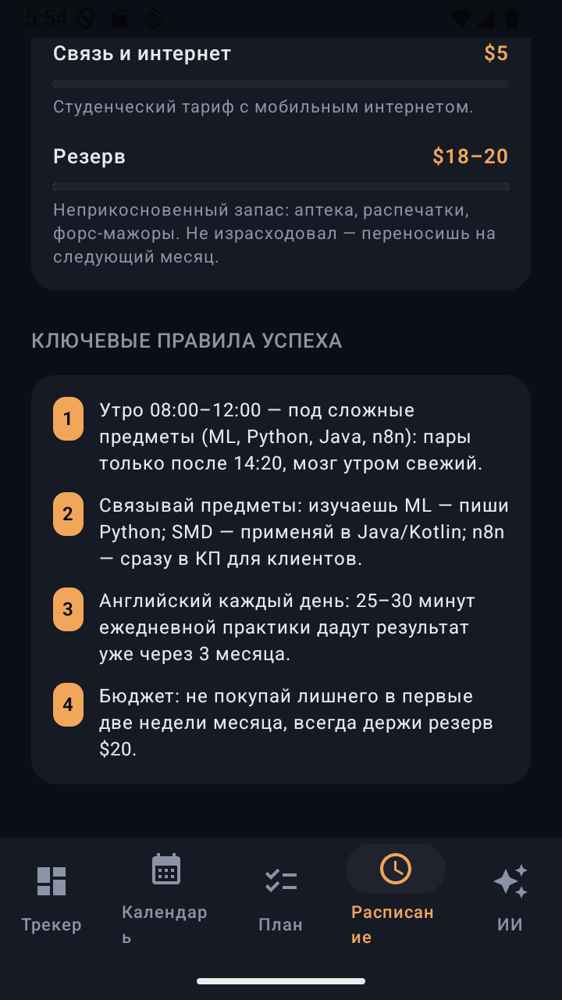
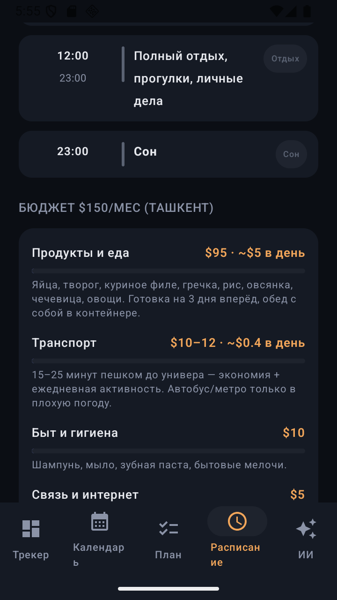
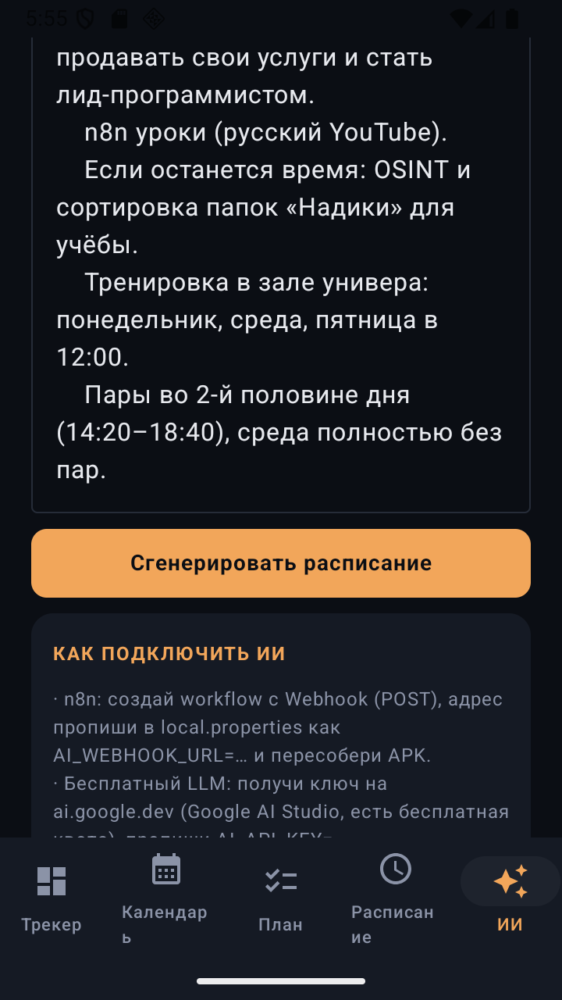

# 📱 Habit Tracker — Kotlin + Jetpack Compose

Личный трекер привычек: **Трекер + Календарь + План на день** в тёмной теме. Портирован с React-монолита ([Habittraker.jsx](Habittraker.jsx)) на нативный Android.

**APK: [HabitTracker-v1.2.apk](HabitTracker-v1.2.apk)** (16 МБ, Android 8.0+ / API 26) · [AUDIT-отчёт](HabitTrackerAndroid/AUDIT.md)

---

## 🖼 Скриншоты

| Трекер — кольцо прогресса | Кольцо растёт при отметке |
|---|---|
|  |  |

| Привычки и показатели дня | Календарь-heatmap |
|---|---|
|  |  |

| План на день | Отметка «сделано» |
|---|---|
|  |  |

| Расписание — воскресенье | Расписание — бюджет и правила |
|---|---|
|  |  |

| Расписание — бюджет | ИИ-расписание |
|---|---|
|  |  |

## ✨ Возможности

- **Трекер** — кольцо дня/месяца с пружинной анимацией и счётчиком процентов, топ-3 привычки месяца, чек-лист с точками недели, показатели дня (сон ±1ч, настроение 😔😐🙂😀🤩, слова ±50)
- **Календарь** — месячная сетка (Пн-старт), heatmap по доле выполненных привычек, тап по дню → отметка привычек за любую дату
- **План на день** — задачи с категорией/приоритетом/статусом/датой, статистика по категориям и донат по статусам, цитата «ДИСЦИПЛИНА»
- **Расписание недели (v1.2)** — персональная «Идеальная неделя»: тайм-слоты Пн–Вс под реальное расписание универа (пары после 14:20, зал в 12:00 Пн/Ср/Пт, среда без пар), цветные метки типов активностей (пары/зал/учёба/английский/дорога/сон), таблица бюджета $150/мес с полосками и «Ключевые правила успеха»
- **ИИ-расписание (v1.2)** — опишешь свой распорядок текстом → приложение отправляет промпт в **n8n webhook** или **бесплатный LLM** (Google AI Studio / Gemini free tier) и превращает ответ в задачи вкладки «План». Ключ/адрес задаются в `local.properties` (не коммитятся): `AI_WEBHOOK_URL=…` либо `AI_API_KEY=…`
- **UX-слой v1.1**: bounce-галочка + вибрация при «сделано», press-scale на всех кнопках, свечение кольца и «🎉 Идеальный день!» при 100%, плавные бары прогресса
- **Данные** — SharedPreferences (JSON), автосохранение на каждой мутации, seed-данные при первом запуске

## 🛠 Стек

Kotlin 2.0 · Jetpack Compose + Material 3 · Canvas-графики (без сторонних чартов) · AndroidViewModel · Gradle 8.9 (wrapper включён) · minSdk 26 / target 35

## 🚀 Сборка и запуск

```bash
cd HabitTrackerAndroid
./gradlew assembleDebug        # APK: app/build/outputs/apk/debug/app-debug.apk
./gradlew testDebugUnitTest    # 19 unit-тестов логики
./gradlew lint                 # 0 errors
```

Либо возьмите готовый [HabitTracker-v1.2.apk](HabitTracker-v1.2.apk): скопируйте на телефон и откройте (разрешите установку из неизвестных источников).

### Подключение ИИ (n8n / бесплатный LLM)

1. **n8n**: создайте workflow с Webhook-узлом (метод POST), в `HabitTrackerAndroid/local.properties` добавьте строку `AI_WEBHOOK_URL=https://твой-n8n/webhook/schedule` и пересоберите APK. Ответ ожидается как `"output"` в JSON или простой текст.
2. **Google AI Studio (бесплатно)**: получите ключ на ai.google.dev, добавьте `AI_API_KEY=…` в `local.properties` и пересоберите. Приложение шлёт промпт на `gemini-1.5-flash` (free tier).
3. Ответ ИИ парсится построчно в задачи вкладки «План»: строки вида `08:00–10:30 Java/Kotlin — ООП` станут задачами на сегодня.

## 📂 Структура

```
HabitTrackerAndroid/app/src/main/java/com/habittracker/app/
├── Models.kt          # домен: Habit/Task/DailyLog, даты, dayPercent/monthStats
├── ScheduleData.kt    # персональное недельное расписание, бюджет $150, правила
├── ScheduleScreen.kt  # вкладка «Расписание»: дни, тайм-слоты, бюджет
├── AiScreen.kt        # вкладка «ИИ»: промпт → n8n/Gemini → задачи
├── Store.kt           # seed-данные + JSON (де)сериализация
├── AppViewModel.kt    # состояние + persist, пересчёт «сегодня» на resume
├── Theme.kt           # палитра #0B0E14 / #F2A65A …, типографика
├── HabitApp.kt        # Scaffold, нижняя навигация (5 вкладок), pressable
├── RingProgress.kt    # анимированное кольцо + glow при 100%
├── Common.kt          # CheckSquare (bounce+haptic), бары, точки недели
├── TrackerScreen.kt   # экран Трекера
├── CalendarScreen.kt  # экран Календаря
├── PlanScreen.kt      # экран Плана
└── Haptics.kt         # тактильная обратная связь
```

## ✅ Качество

- 19/19 unit-тестов (даты, сетка месяца, monthStats, JSON round-trip)
- Android Lint: 0 errors
- Протестировано на эмуляторе API 36: скроллы, все 5 вкладок, отметки — 0 крашей
