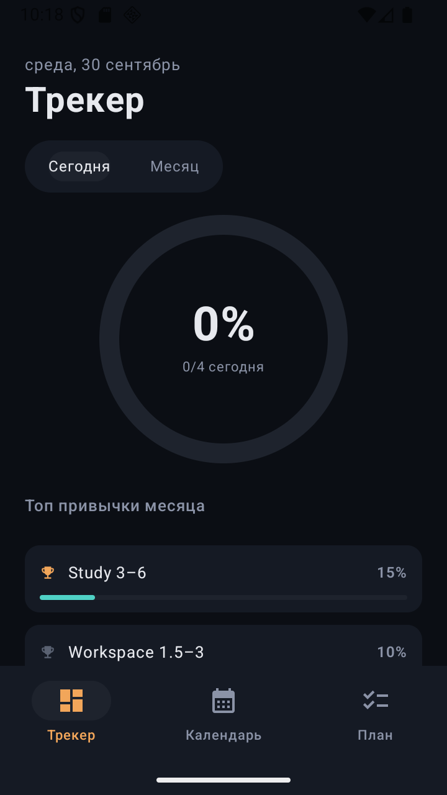
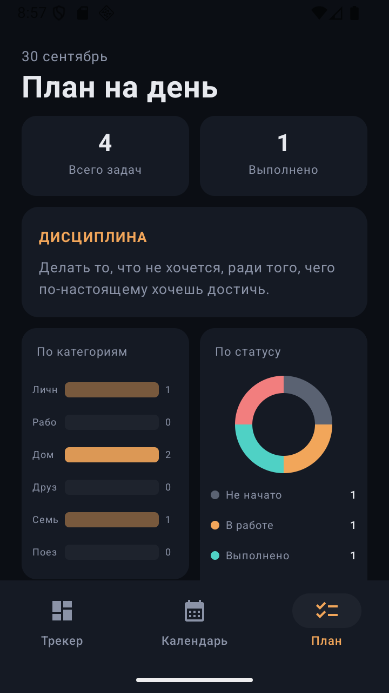
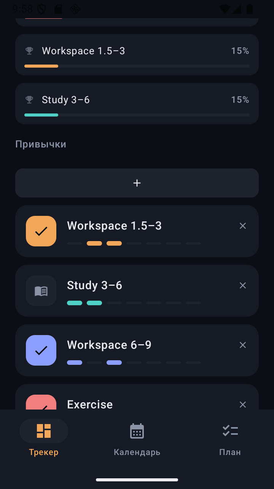
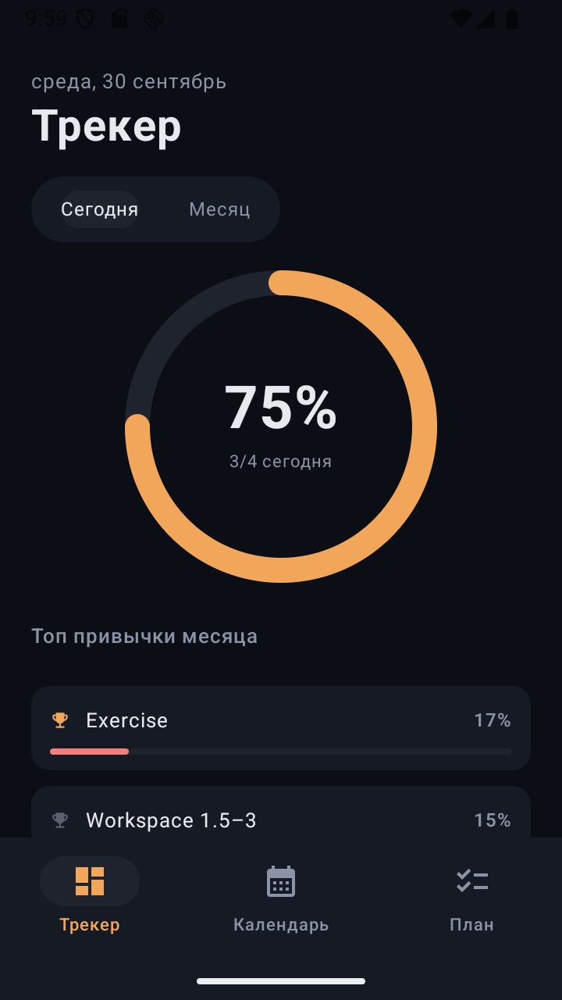

# HabitTracker

HabitTracker — локальный трекер привычек, ежедневных показателей и задач. Репозиторий содержит нативное Android-приложение на Kotlin/Jetpack Compose и веб-версию на React/TypeScript.

## Скриншоты

| Трекер привычек | Планировщик |
|---|---|
|  |  |
| **Отметка выполнения** | **Кольцо прогресса** |
|  |  |

## Возможности

- отметка выполнения привычек по дням;
- дневной и месячный прогресс;
- календарь с историей активности;
- планировщик задач с категориями, приоритетами, сроками и статусами;
- учёт сна, количества слов и настроения;
- анимации прогресса, тактильный отклик и адаптивный интерфейс в Android-версии;
- локальное хранение данных без регистрации и доступа к интернету.

## Готовая Android-версия

В корне репозитория находится готовый APK:

- `HabitTracker-v1.1.apk` — актуальная версия 1.1;
- `HabitTracker-debug.apk` — отладочная сборка.

Для установки разрешите установку приложений из неизвестных источников и откройте APK на устройстве. Минимальная поддерживаемая версия — Android 8.0 (API 26).

> APK подписан отладочным ключом и предназначен для тестирования, а не для публикации в Google Play.

## Структура проекта

```text
.
├── HabitTrackerAndroid/   # Нативное Android-приложение
├── Habittraker/           # Веб-версия на React/TypeScript
├── screenshots/           # Скриншоты интерфейса
├── HabitTracker-v1.1.apk  # Готовая Android-сборка
└── Habittraker.jsx        # Исходный JSX-прототип
```

## Запуск Android-приложения

### Требования

- Android Studio с Android SDK 35;
- JDK 17;
- Android-устройство или эмулятор с API 26+.

Откройте каталог `HabitTrackerAndroid` в Android Studio, дождитесь синхронизации Gradle и запустите конфигурацию `app`.

Сборка из терминала:

```bash
cd HabitTrackerAndroid
./gradlew assembleDebug
```

В Windows:

```powershell
cd HabitTrackerAndroid
.\gradlew.bat assembleDebug
```

Собранный APK появится в `HabitTrackerAndroid/app/build/outputs/apk/debug/`.

Проверки Android-проекта:

```powershell
.\gradlew.bat test
.\gradlew.bat lint
```

## Запуск веб-версии

### Требования

- Node.js 18+;
- npm.

```bash
cd Habittraker
npm install
npm start
```

После запуска приложение будет доступно по адресу `http://localhost:3000`.

Другие команды:

```bash
npm test       # unit-тесты
npm run build  # production-сборка
```

## Технологии

### Android

- Kotlin 2.0;
- Jetpack Compose и Material 3;
- Android ViewModel;
- SharedPreferences и JSON для локального хранения;
- JUnit 4.

### Web

- React 18;
- TypeScript 5;
- Recharts;
- Jest и Testing Library;
- Create React App.

## Хранение данных

Привычки, задачи и дневные показатели сохраняются только на устройстве. Android-приложение не запрашивает разрешения и не требует сетевого подключения.

## Статус

Android-версия 1.1 прошла unit-тесты и lint-проверку. Подробные результаты и история исправлений находятся в [`HabitTrackerAndroid/AUDIT.md`](HabitTrackerAndroid/AUDIT.md).

## Лицензия

Лицензия пока не указана. Перед распространением или использованием проекта в коммерческих целях добавьте файл `LICENSE`.
